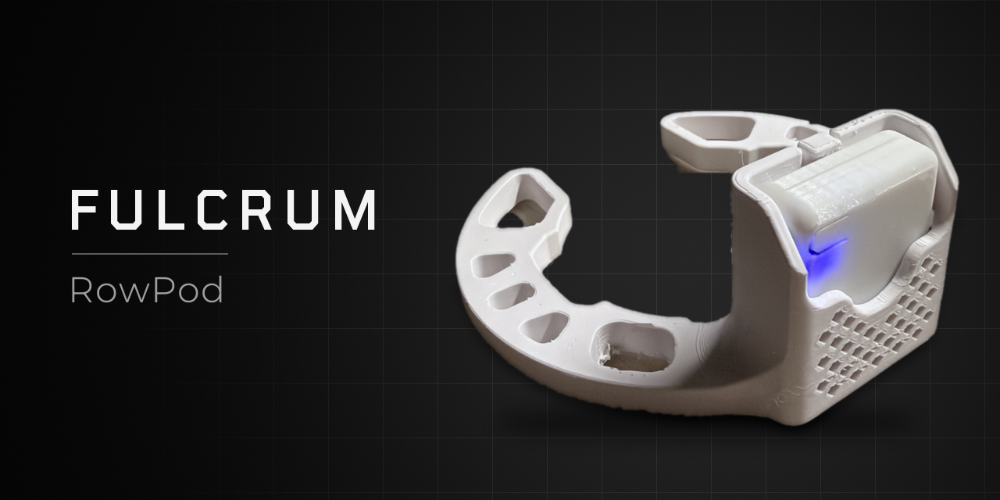
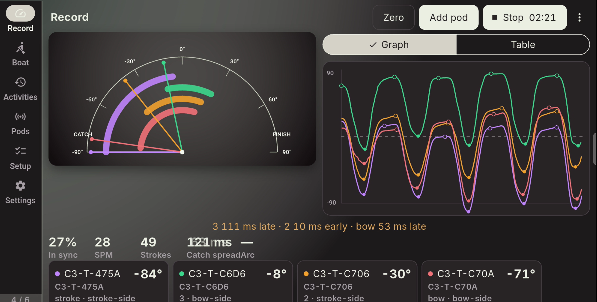
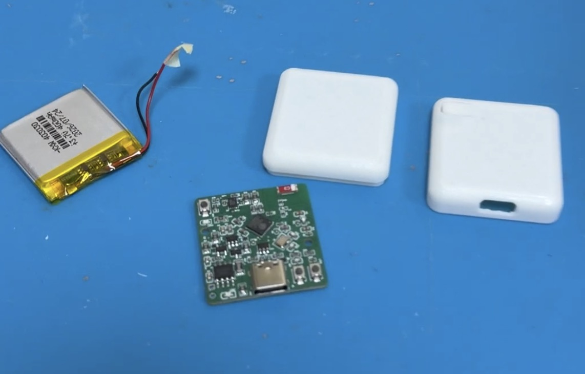
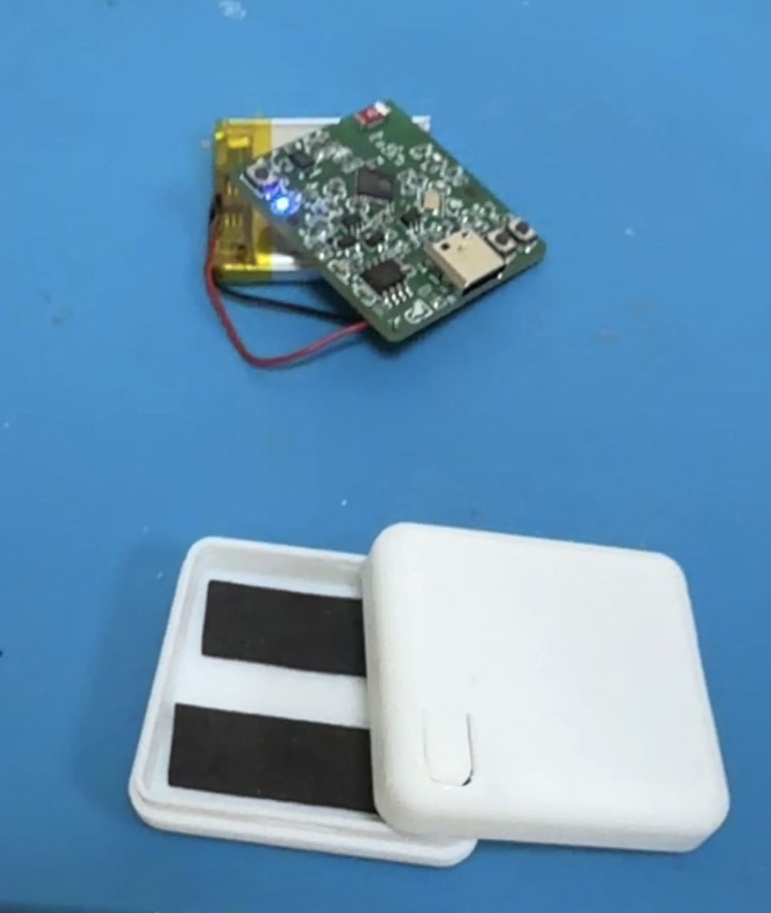

# RowPod

Oar-mounted telemetry for rowing crews. Four pods, one screen: the tablet draws every connected oar from catch to finish.



Each pod is a 4-layer board with an **ESP32-C3FH4** and a QMI8658A. It measures oar angle and sends it over Bluetooth. RowPod v2 has no magnetometer. The same pods talk to two hosts: the Android tablet app, and the browser dashboard.

## What the pod is built to do

These figures are the firmware and host limits. Protractor error, hours on the cell, and radio range in metres have a written method and no filled-in result. Procedures: [`docs/test_protocols/`](docs/test_protocols/). Crew timing math: [`docs/ROWING_SYNC.md`](docs/ROWING_SYNC.md).

| Limit | Figure |
|---|---|
| Live sample rate | 56 Hz on the rowing profile, so several pods can share one radio |
| Other sample rates | 112 Hz, 224 Hz, and 448 Hz. 448 Hz is the one-pod lab capture |
| Pods on one host | 2–4. Each pod accepts one Bluetooth central. An eight does not fit on one phone |
| Connection interval | The pod requests 15–30 ms while motion notifications are on |
| Catch-event interpolation | About 1–3 ms. Error budget for a linear zero-crossing between 56 Hz samples |
| Software clock | About 5–10 ms after a few fits. Error budget. This term dominates crew timing |
| Two pods on one stick | Host test allowance: catch times within 15 ms |
| IMU full scale | ±16 g and ±2048 °/s |
| Sleep | 3 minutes with no Bluetooth link, then deep sleep. A 2-second button hold wakes the pod |
| Cell | 400 mAh, 403030 |
| Radio range | Not measured |

Catch spread in milliseconds is the crew number this build is meant to show. Absolute degrees need the protractor check and a Zero in [`docs/ROWING_SYNC.md`](docs/ROWING_SYNC.md).

The Record page is the one used on the water. This piece has four pods. The fan is the live angle, the graph is the last few seconds, and catch spread is how far apart the catches are.



The current tablet build is **1.5.4** (version code 7), package `org.rowpod.app`:

[download/rowpod_1.5.4.apk](download/rowpod_1.5.4.apk)

How to install it and use the six screens: [download/README.md](download/README.md). Allow “install unknown apps” on the tablet. The web dashboard below is the other host.

A pod is a board, a lithium-polymer cell, and a printed shell. The cell sits on two foam strips. The blue LED shows the pod is awake.




The housing and the oar clamp are printed from [MakerWorld](https://makerworld.com/en/models/3547180-rowpod-open-source-oar-sensor#profileId-4057732). That listing is an Exclusive model, so the print files are not in this repo. The mount is not an official Concept2 product.

## Flash a pod

The try-out image is one file, [firmware/rowpod.bin](firmware/rowpod.bin). It already contains the bootloader, the partition table, and the app. The chip is an ESP32-C3. You do not need ESP-IDF for this.

Use Espressif's [Flash Download Tool](https://docs.espressif.com/projects/esp-test-tools/en/latest/esp32c3/production_stage/tools/flash_download_tool.html) on Windows. The installer is on the [Espressif download page](https://www.espressif.com/en/support/download/other-tools).

1. Open the tool and choose chip type **ESP32-C3**.
2. Add one row: `rowpod.bin` at address **0x0**.
3. Set SPI mode to **DIO** and SPI speed to **80 MHz**. Tick **DoNotChgBin**. This image was built with a 2 MB flash map. The C3FH4 part is 4 MB, and the program lives in the first 2 MB.
4. Plug in USB-C, select that COM port, and set the baud to **460800**.
5. Hold **B**, tap **RST**, release **B**, then click **START**. **B** is the boot button. **RST** resets the chip. **SW1** is the user button and does not enter the flash mode.
6. After the tool reports success, hold **SW1** for about 2 seconds. The blue LED breathes, and the pod advertises as `C3-T-` plus four characters.

On macOS or Linux, the same file flashes with esptool:

```sh
python -m esptool --chip esp32c3 -b 460800 write-flash 0x0 firmware/rowpod.bin
```

If no serial port appears, hold **B**, tap **RST**, and release **B** before the command.

## Web dashboard

Hosted coach UI **1.5.6**, Chrome or Edge:

`https://mhyeung.github.io/RowPod/?v=1.5.6`

IMU lab (plots, HYROX, mag-cal CSV) is [`lab.html?v=16.13`](https://mhyeung.github.io/RowPod/lab.html?v=16.13). Actions publishes only `web/ble_plotter/`. The firmware is not part of that site. One-time Pages setup: [`docs/DASHBOARD_PAGES.md`](docs/DASHBOARD_PAGES.md).

**Local fallback:**

```sh
cd web/ble_plotter
python -m http.server 8080
```

Open `http://localhost:8080/?v=1.5.6`, click **Add pod**, select a tracker. Lab: `http://localhost:8080/lab.html?v=16.13`.

Rowing detail: [`docs/ROWING_SYNC.md`](docs/ROWING_SYNC.md) and
[`docs/ROWPOD_ECOSYSTEM.md`](docs/ROWPOD_ECOSYSTEM.md). Next slices:
[`docs/ROWPOD_NEXT.md`](docs/ROWPOD_NEXT.md).

## Pod identity and host selection

- Every firmware pod is permanently a single-node BLE peripheral.
- The default advertised name is unique: `C3-T-XXXX` (stable pod id from NVS/MAC).
- The dashboard host selects one or multiple pods by using **Add pod** for each
  device; no device-side mode switch is required.
- After three minutes with no BLE link the pod enters deep sleep. Hold GPIO0
  for ~2 s to boot again; a shorter press is ignored and the pod stays asleep.
- In a connected pod, single-tap pauses/resumes the BLE sensor stream.
- Dashboard rename writes the position name into the pod NVS and becomes the
  BLE advertised name (max 20 chars). Motion service UUIDs stay fixed.
- Software clock sync estimates millisecond-scale offsets for overlay/CSV; it
  is not sample-level IMU phase lock.
- Target 2–4 simultaneous Web Bluetooth pods; each first connect needs a
  browser gesture.

## Project structure

```
.
├── main/                 Orchestration only (app_main)
├── components/
│   ├── board/            Pin / address map
│   ├── device_config/    NVS name, pod id, oar side/zero, fixed single-node identity
│   ├── i2c_bus/          Single I2C master owner
│   ├── qmi8658/          IMU driver
│   ├── mahony/           On-device AHRS (gyro + accel; yaw is not mag-corrected)
│   ├── sensor_protocol/  BLE wire frames (v1 / v16 / fused / coach summary) + UUIDs
│   ├── rowing_metrics/   On-pod catch/finish/arc (port of the browser tracker)
│   ├── sensor_stream/    Native-clock 56/112/224/448 Hz DRDY stream + Mahony
│   ├── ble_tracker/      NimBLE peripheral + queued packet batching / drain
│   ├── ui/               Blue status LED + button gestures
│   ├── battery/          ADC oneshot on GPIO2 → pack mV / %
│   └── power/            Three-minute deep-sleep policy (GPIO0 wake)
└── web/ble_plotter/      Local Web Bluetooth UI
```

## Hardware

The cell is a 400 mAh 403030 LiPo, soldered to the board. It is not a printed part.

Photographs of the printed shell and the clamp are in `download/images/`. The print files themselves stay on [MakerWorld](https://makerworld.com/en/models/3547180-rowpod-open-source-oar-sensor#profileId-4057732). Sleeve dimensions for the clamp are not written down here. The mount is not an official Concept2 product.

Board files, revision RowPod2 V1.0. Order the Gerber zip as a 4-layer board.

- Schematic: [pcb/SCH_rowpod_SCH_2026-11-05.pdf](pcb/SCH_rowpod_SCH_2026-11-05.pdf)
- Board drawing and bill of materials: [pcb/PCB_rowpod_2026-11-05.pdf](pcb/PCB_rowpod_2026-11-05.pdf)
- Gerbers: [pcb/rowpod_gerber.zip](pcb/rowpod_gerber.zip)
- 3D board: [pcb/rowpod_PCB.step](pcb/rowpod_PCB.step)
- Render: [pcb/rowpod_pcb_render.png](pcb/rowpod_pcb_render.png)
- LCSC order: [pcb/rowpod_bom.xlsx](pcb/rowpod_bom.xlsx)
- Assembly guide: [pcb/RowPod_assembly_guide.pdf](pcb/RowPod_assembly_guide.pdf)

## Build with ESP-IDF

[firmware/rowpod.bin](firmware/rowpod.bin) is already built. To compile it yourself, install ESP-IDF **6.0.1** and set the target to **esp32c3**.

```sh
idf.py set-target esp32c3
idf.py build
idf.py -p COMx flash monitor
```

The console is the USB Serial/JTAG port on the same USB-C socket. If that port does not appear, hold **B**, tap **RST**, and release **B**.

## Adding a component

1. Create `components/<name>/` with `include/`, `<name>.c`, `CMakeLists.txt`.
2. Add it to `main/CMakeLists.txt` `REQUIRES`.
3. Call `<name>_init()` from `app_main` with `ESP_ERROR_CHECK`.

## Logging

Use `ESP_LOGI` / `ESP_LOGW` / `ESP_LOGE` — never `printf`.
The single-tap action controls BLE streaming; CSV capture remains in the
browser dashboard and is not stored in pod flash.
The session/status lifecycle and CSV provenance fields are documented in
[docs/SESSION_PROTOCOL.md](docs/SESSION_PROTOCOL.md).

For calibrated, quality-gated short arm-stroke capture and reconstruction, see
[docs/TRAJECTORY_CAPTURE.md](docs/TRAJECTORY_CAPTURE.md).
For station-aware training metrics, see
[docs/HYROX_TRAINING.md](docs/HYROX_TRAINING.md).
For repeatable runtime and battery-power characterization, see
[docs/test_protocols/BATTERY_RUNTIME_TEST.md](docs/test_protocols/BATTERY_RUNTIME_TEST.md).
For v16 throughput / drain integrity, see
[docs/test_protocols/V16_THROUGHPUT_DRAIN_TEST.md](docs/test_protocols/V16_THROUGHPUT_DRAIN_TEST.md).

See [BRINGUP.md](BRINGUP.md) for staged hardware bring-up notes.

## License

The firmware (`main/`, `components/`) and the browser host (`web/`, `tools/`) are under the MIT License. See [LICENSE](LICENSE).

The board files in `pcb/` are not part of that grant.

The printed housing and oar clamp are on MakerWorld under the Standard Digital File License – Community Use, and the listing is in the Exclusive program. That is a separate grant from this repository.
