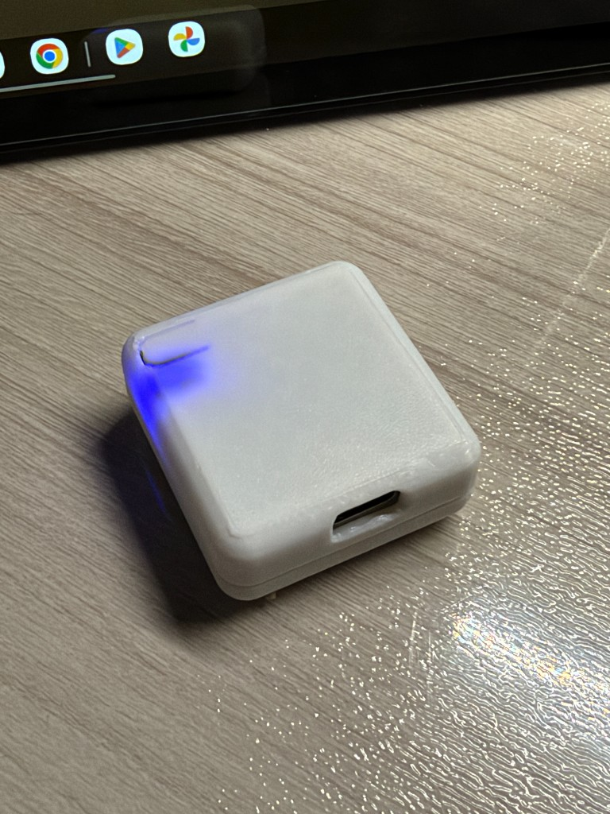
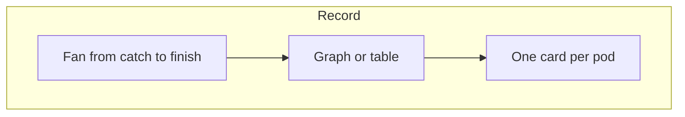
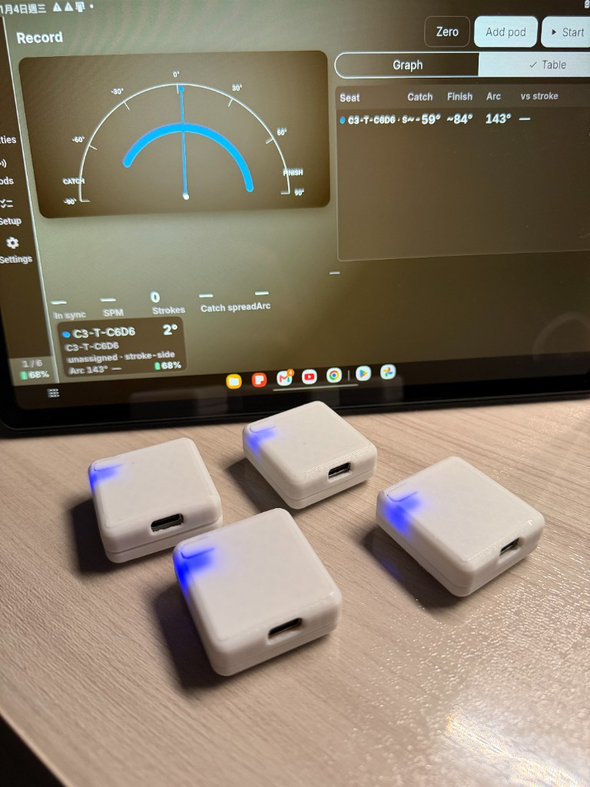
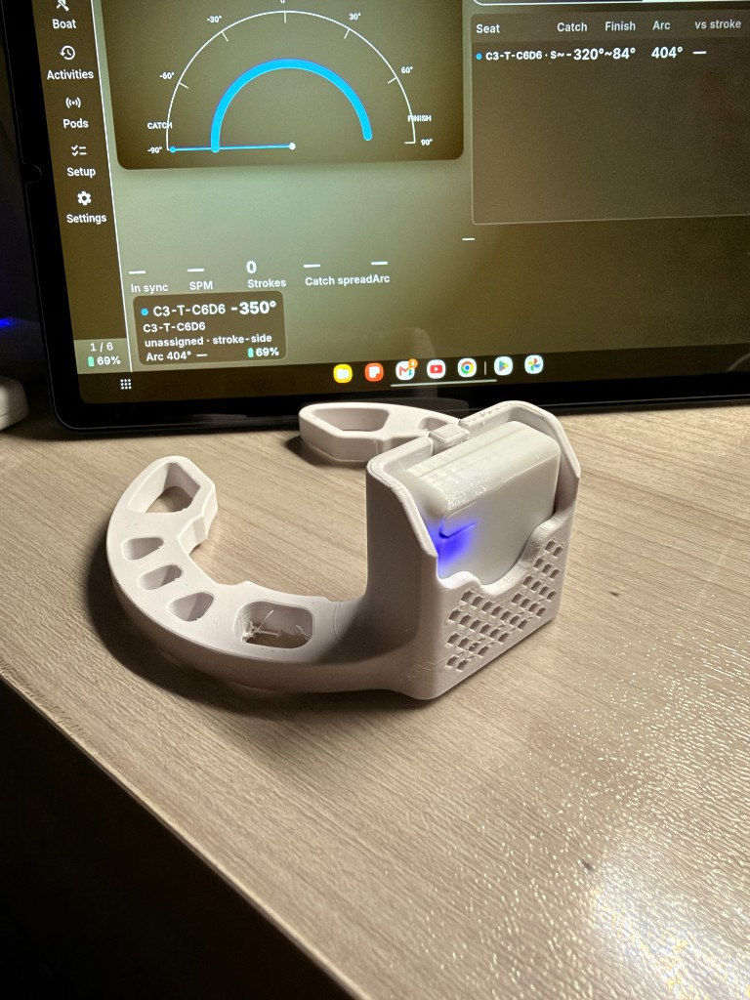

# RowPod tablet app 1.5.4

Android app for the oar pods. Landscape only. Package `org.rowpod.app`, version code 7.

[rowpod_1.5.4.apk](rowpod_1.5.4.apk)

This build is a preliminary release. It coaches from live oar angle. It does not replace a calibrated speed coach.

## Install

1. Copy `rowpod_1.5.4.apk` onto the tablet, or download it from this folder.
2. Allow install from unknown apps for the Files app.
3. Open the APK and install. Android may warn that the app is not from the Play Store. That is expected.
4. On first launch, allow **Nearby devices** (Bluetooth). Without that permission the app cannot see a pod.

The app does not need a network connection on the water. Bluetooth has to be on.

## Wake a pod

The blue LED sits in a slot on the corner of the white housing. USB-C is on the near edge and is for charging.

- Asleep: LED off, and the pod does not appear in a scan. Hold the button for about 2 seconds until the LED breathes.
- Awake and advertising: LED breathes, as in the photo.
- Connected: LED stays dim.
- A short press while the pod is asleep does nothing. A short press while it is connected pauses or resumes the live stream.

If nobody connects, the pod goes back to sleep after about 3 minutes.

## One piece

1. Open **Record** and tap **Add pod**. Select the name `C3-T-XXXX`. Repeat for each oar. Four pods on one tablet is the practical limit.
2. Open **Pods**. Tap a pod and set the crew name if you want one. That name stays on this tablet. The pod keeps advertising as `C3-T-XXXX`.
3. Open **Boat**. Choose the boat class, which side the stroke sits, and the inboard and outboard lengths. Tap a seat card to assign the pod, the seat, and stroke-side or bow-side.
4. Square the blade, perpendicular to the boat, and tap **Zero**. Degrees after that are measured from this pose.
5. Tap **Start**, row, then tap **Stop**. With **Save a session when a piece stops** left on, the piece appears under **Activities**. Disconnecting the last pod also keeps a piece that already has strokes.

**In sync** stays `—` with one seat. It is a comparison of two catches, so it needs two pods that both reach a catch and a finish.

## The screen

The app is landscape. A rail on the left switches pages. On a narrow tablet the rail is icons only. The names are **Record**, **Boat**, **Activities**, **Pods**, **Setup**, and **Settings**.

**Record** is the towpath page. With a pod connected and sitting still, the fan needle rests near zero and the card shows a small angle.

- The fan is the live oar angle. Catch is toward the left of the arc, finish toward the right. The scale is −90° to 90°.
- **Graph** is the angle over the last few seconds. **Table** lists seat, catch, finish, arc, and versus stroke.
- Each card shows the pod, the crew name, the side, the arc, and the battery percentage. The photo shows `C3-T-C6D6`, unassigned, stroke-side, and the pack at 68%.
- **Zero**, **Add pod**, and **Start** are along the top. **Stroke CSV** shares the strokes from the current piece. **Disconnect all** drops every link.

The clamp holds the same housing on a Concept2 oar sleeve. The pod's LED faces out so you can see that it is awake. Print files for the housing and this mount are on [MakerWorld](https://makerworld.com/en/models/3547180-rowpod-open-source-oar-sensor#profileId-4057732). The listing is Exclusive, so those files are not stored here.

**Boat** is the rig. Class, stroke side, which seats are sampled, and the oar lengths are here, above a line drawing of the shell. Seat cards sit on the oar ticks. A card with no pod says the seat is empty.

**Activities** lists saved pieces by day. Open one for SPM, catch spread, and arc. Share or delete from that page. The list does not depend on a pod still being connected.

**Pods** is link health: battery, rate, missed frames, and whether the motion is raw gyro. Use this page when a pod connects but the fan does not move.

**Setup** is the first-session checklist: charge, wake, mount, add, name, confirm the boat, row one stroke.

**Settings** is the in-sync window, saving sessions, keeping the screen awake, light or dark theme, and deleting stored pieces. The boat class is not here. It is on **Boat**.

## Battery percentage

The percentage is estimated from pack voltage, not from a fuel gauge. It can fall several tens of percent when you unplug the charger or when the radio is busy, then recover after the cell rests. Read the volts on the **Pods** card if the percentage looks sudden.

## What this app does not do

- No iPhone build.
- No lab plots, HYROX, or magnetometer calibration. Those stay on the web IMU lab.
- In sync is not a power or pace figure. Arc is the angle swept on the drive, not distance through the water.

## Other hosts

The browser PWA and IMU lab are in [`../web/ble_plotter/`](../web/ble_plotter/)
and are versioned in `version.js`, independently of this APK. They share the
same pod firmware and GATT services, not this binary. Flash a pod with
[`../firmware/rowpod.bin`](../firmware/rowpod.bin) if it is not already
running. Motion links request 15–30 ms so four pods can share one tablet.
